*In August 2026 I organised a two-week fieldwork expedition across Zambia, following its rivers from the northern plateau to the Luangwa Valley and the Kafue, on the trail of sediments, climate and hominin migration.*<!--more-->

The team I put together brought colleagues from UCL, the University of the Witwatersrand (Wits), the University of Zambia (UNZA), and the University of Milano-Bicocca (UNIMIB). Our goal was to study the geomorphology, river sediments and environment of the northern plateau and the Luangwa Valley, as part of the [PLIODIS](https://pliodis.github.io/) project. This is the story of that trip.

## Two rivers, two oceans

The Central African Plateau and the Luangwa Valley are drained by two great river systems that carry sediments to opposite sides of the continent. The Chambeshi-Luapula flows north and west, into Lake Mweru and onward through the Congo system to the Atlantic. The Luangwa flows the other way, feeding the Zambezi and reaching the Indian Ocean. Standing on the plateau, you are on a watershed between two oceans.

  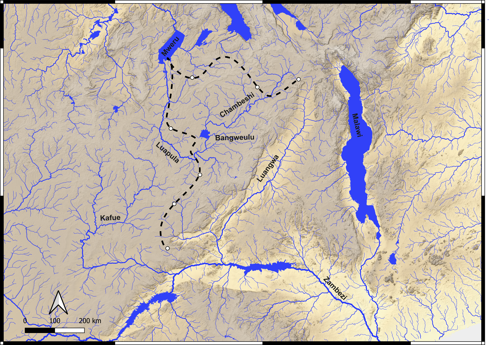

The idea I wanted to test is that these two river systems, and the broad valleys they carve, may have acted as natural corridors for the movement of mammals, including hominins, in the deep past. The idea is supported by the landscape itself: the thriving Miombo woodland that covers much of the region combines abundant water with large expanses of gentle, relatively flat terrain, the kind of country that is easy to cross.

## Reading the landscape's past

Landscape evolution modelling suggests that, over the last four million years, erosion and tectonic movement have reshaped the topography of this region, changing where rivers run, how steeply they flow, and the environments along their banks. Our reconstructions hint that the Chambeshi once joined the Kafue in a single long valley, before being captured, its flow diverted, by the Luapula system in the Bangweulu Wetlands, a place of exceptionally flat ground and slow, spreading water. A corridor that was open in one configuration of the landscape may have closed in another. Working out when these switches happened is what the fieldwork is for.

## What we collect, and why it matters

**Sand carries a fingerprint.** Sieved and separated into its individual minerals, river sand reveals the erosional signature of each catchment. One mineral, zircon, can be dated by the U-Th-Pb method. Each grain effectively carries the age of the rock it eroded from. By tracing that signal from the modern rivers down into the places where sediment accumulates (the "sink"), and by reading it in sediment cores, we can reconstruct how the source-to-sink system worked in the past. That gives landscape modelling the hard constraints it needs to show how river networks reorganised through time.

  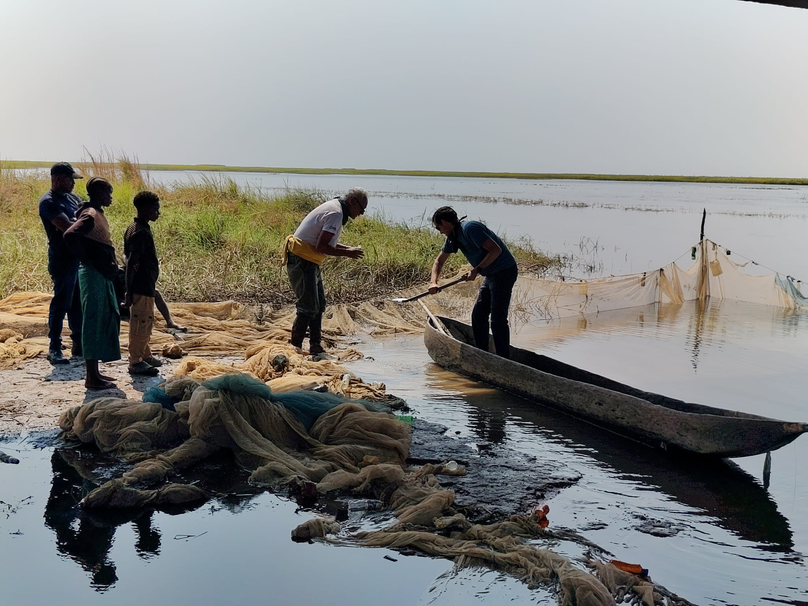

**Mud records the climate.** At the intersection of water and rock, weathering produces clay minerals, and those clays are sensitive recorders of seasonal climate. A dense set of mud samples spanning the plateau and the rift valley can trace the climatic boundaries that shape today's vegetation, and by extension the environments that would have been available to animals and early humans.

**Plants and pollens.** Alongside the sediment work, we sampled modern vegetation, grasses and the leaves of trees and shrubs, to characterise the isotopic signal that ends up locked in soils. This builds a present-day reference for how that signal is distributed across the plateau and the valley. Paired with it is the collection of palaeosol (ancient soil) samples for pollen analysis, a window into past vegetation and, through it, past shifts in climate and in the environments that would have been favoured by hominins.

  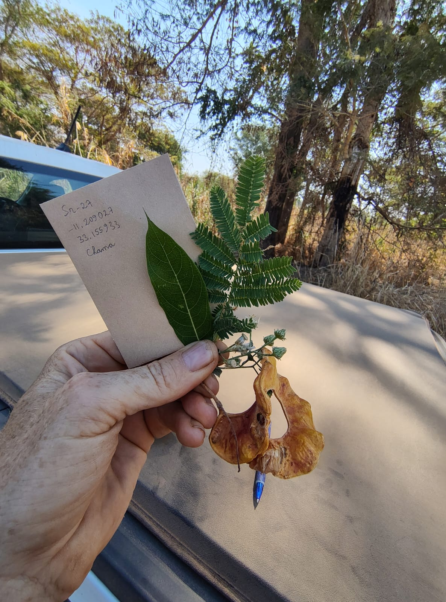

## Field diary

**The route:** Lusaka → Kabwe → Serenje → Lake Bangweulu → Mansa → Mambilima Falls → Lake Mweru → Mporokoso → Kasama → Isoka → Chama → Lundazi → Mfuwe → Nyimba → Rufunsa → Zambezi confluence → Kafue → Kafue National Park → Lusaka

### The plateau

We set out from Lusaka on 4 August. The first leg of the route I had planned took us through Kabwe and Serenje towards Lake Bangweulu. The plateau rivers here are flat, swampy, and produce remarkably little sand. Crossing the Luapula south of the wetlands, where it is still flowing south, we could gather only mud. It was on the beaches of Lake Bangweulu, its basin controlled by faulting, that we finally found clean white quartz sand.

  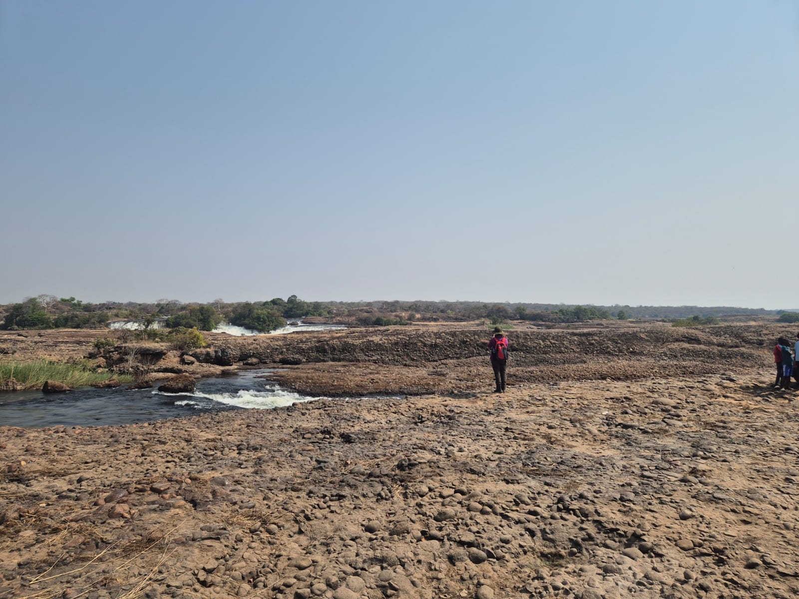

After a stop in Mansa we followed the Luapula valley, tracing the river back northward. At the Mambilima Falls the river tumbles over a knickpoint, a step in its long profile, cutting through ancient, extremely well-cemented conglomerates. Beyond it we reached Lake Mweru, where the valley opens out and the Luapula slows once more into a meandering, swampy channel before emptying into the lake.

  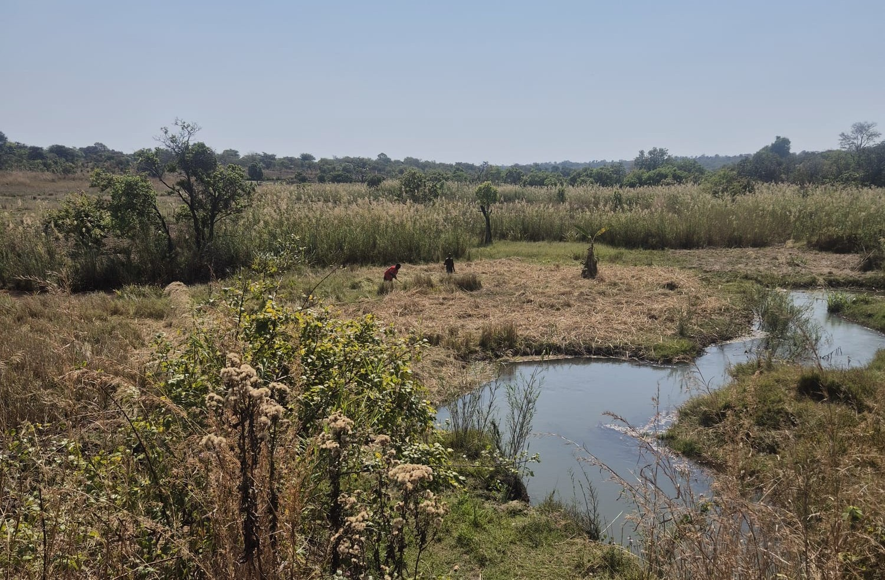

Turning west towards Kasama, we met a succession of waterfalls large and small. Each is an erosional knickpoint, and each could be the product of a lithological contrast or a sign of more recent upheaval, due to the landscape still adjusting to tectonics or to a captured river. The Chishimba Falls, dropping more than twenty metres through Mesoproterozoic sandstone, were a remarkable observational spot.

  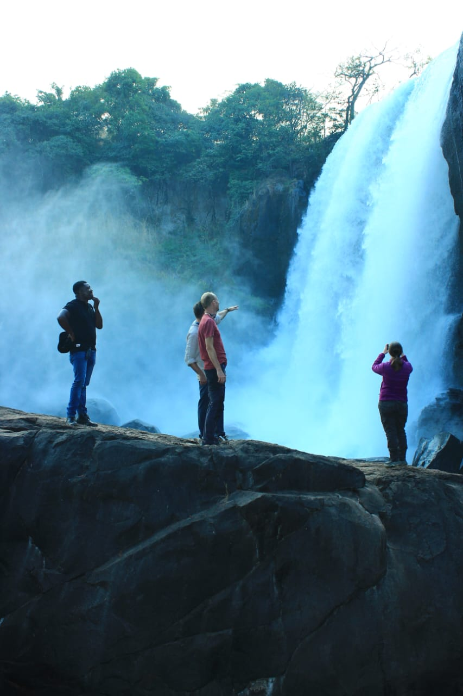

What we found on the plateau was a water-rich country of placid rivers and soft, open landscapes: a favourable place to live and, perhaps, a natural route to travel, which is precisely the possibility [PLIODIS](https://pliodis.github.io/) set out to test. After resting for a day in Isoka, we turned towards the Luangwa, a river that runs through a tectonically controlled valley with steep shoulders and a broad, flat floor, where we expected a change of character: more sand, a hotter climate, and more varied vegetation.

### The life of a river

Following a river along its entire course mirrors a human life. It begins as a small torrent, its water sparse and crystal clear, then grows into a broader channel (and gains a great many crocodiles), matures into a meandering course, and reaches its final stage as placid, sandy shores that plunge at last into another river or an ocean.

Before entering the Luangwa Valley proper, we reached the uppermost part of the Luangwa catchment, and there, at last, we found sand. A pile of sand. The contrast with the plateau's sediment system was striking. What controls this difference in sand and mud generation? A debate broke out among us. Is it the tectonically controlled steepness of the valley? The more humid climate of the plateau? Or the presence, in the valley, of the Karoo sedimentary sequence, softer rocks more readily eroded into sand? The team split into rival parties... but we remain friends.

  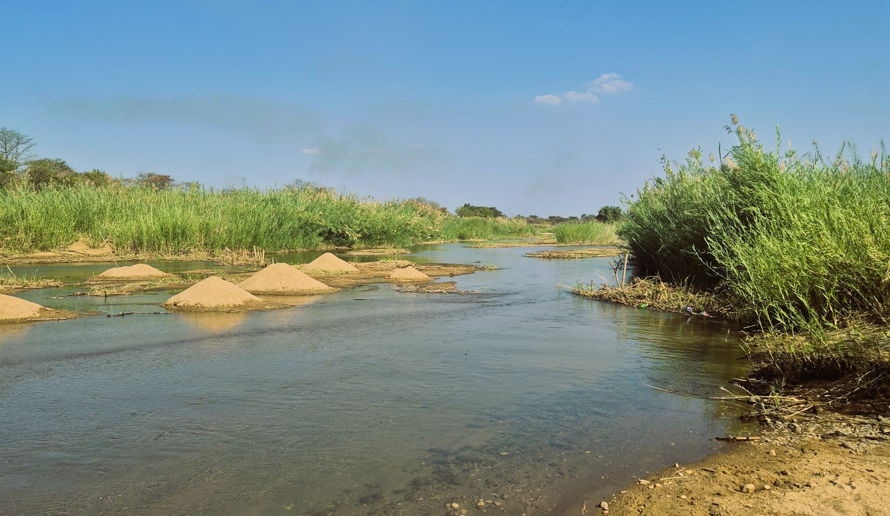

### The Luangwa Valley

Then we faced the same problem as any early hominin would have: how to cross the Luangwa River? To enter the valley and reach Chama, my route relied on a single bridge, and there was no way to know from a distance whether it was still standing. A local contact told me he had seen it, and the satellite images were reasonably recent, but others advised us to drive all the way back to Lusaka and enter the valley from the south. I decided we would go and see for ourselves. A long dirt road stretched on into a national park, and among the tracks of elephants we descended the flanks of the valley. As we neared the crossing, my mood swung between anxiety and hope. And then, finally, the bridge was there. We could enter the Luangwa!

  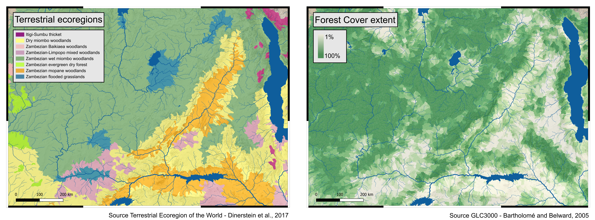

A change of landscape, and a change of environment! We left the plateau behind, with its characteristic evergreen miombo trees (*Brachystegia*, *Julbernardia* and *Isoberlinia*) and the swampy dambos of the Bangweulu Wetlands. The Luangwa welcomed us instead with the sparser, less densely forested mopane woodland (*Colophospermum mopane*). Peering from the car through this thinner vegetation, and now crossing major national parks, we caught our first sight of baboons, warthogs, impalas and elephants. The drier climate also favoured a tree we had not yet seen: the baobab (*Adansonia digitata*).

  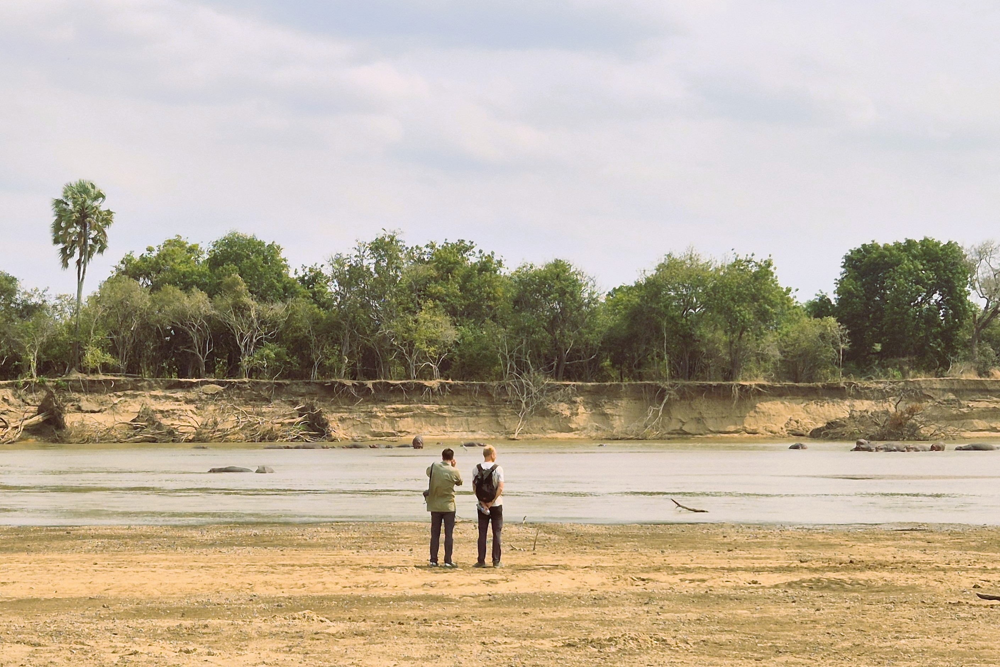

Over the next couple of days, we descended twice more to the river, over difficult terrain, through river crossings and national parks alive with an astonishing variety of animals. The main towns, Chama and Lundazi, sit on the upper flanks of the valley, on the metamorphic rocks of the Irumide Belt. The Luangwa itself runs along the opposite side of the valley, carving and eroding the Karoo sedimentary sequence. Along its flat central reach, the river shows some extraordinary meanders, some still evolving, others long abandoned.

### Mfuwe and Steve

Following the Luangwa downstream, I knew we had to pay a visit to Steve Tolan, who runs the Chipembele Wildlife Education Trust ([chipembele.org](https://www.chipembele.org)) and is searching for the first early-hominin fossil in the Luangwa Valley. Steve welcomed us and showed us his outstanding outreach museum and his fossil finds from the valley (not yet of our ancestors). We talked about hominins and the remarkable environment around Mfuwe, though for far too short a time before it was already time to climb back into the car.

  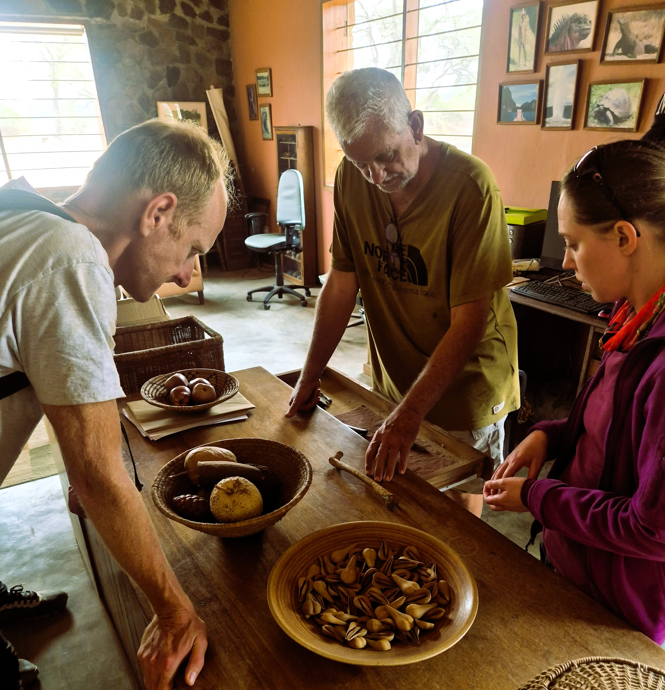

### Leaving the Luangwa, stretching to the Zambezi

Our route led us to the southernmost part of the Luangwa catchment, reaching down towards the Zambia-Mozambique-Zimbabwe triple junction. Immense sandbar deposits and gentle hills carried us to the confluence of the Luangwa with the Zambezi. After so many days in the valley, it felt like parting from an old friend, and being presented to a regional authority: the mighty Zambezi.

### The Kafue adventure

When I was planning the trip, the first advice I heard was to set aside a couple of days for unplanned adventures: the car, the roads, the inevitable snags. Zambia's roads were unusually kind to us, and we found ourselves with days to spare. Another scientist might have taken some time off. But geologists are a different breed, and I decided instead to drive west, to meet the last of the region's great rivers: the Kafue.

  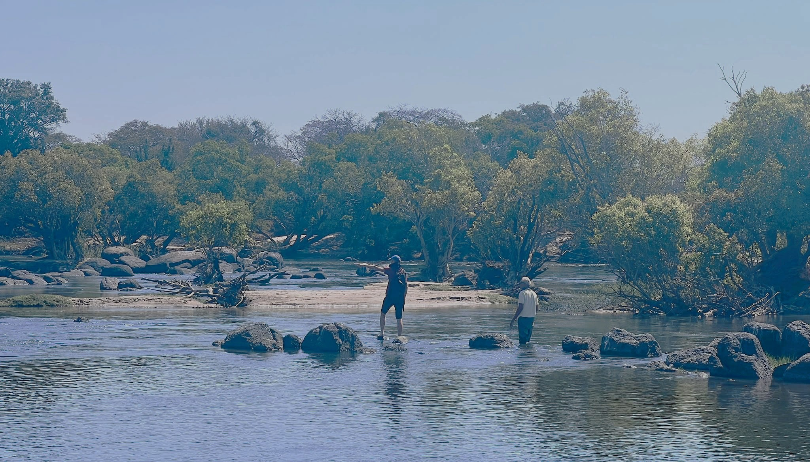

The Kafue sampling really completed my plan. To weigh the possibility of a once-joined Kafue-Chambeshi course, I needed the mineralogical fingerprint of the upper Kafue. Like many rivers in the area, the Kafue is now segmented by a dam, the Itezhi-Tezhi, which currently prevents its sediment signature from reaching the Zambezi. So we travelled north-west to find the river's true signal, and were rewarded with one of the best sampling sites of the whole trip.

### Lusaka and the University

Heading back to the capital on the 17th, the team was satisfied, and tired, after the long loop around Zambia. One task remained: a [research seminar](/assets/images/Zambia/Research_Seminar.pdf) at the Zambia School of Mines, where we met Professor Kawawa Banda to share our background and our research plans. The chance to discuss water management, sediment dispersal, geo-thermochronology and hominin migration in one room was the perfect end to an extraordinary trip.

  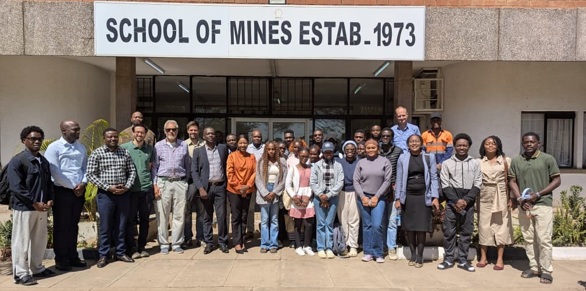

## Conclusion

On the trail of hominin migration, my research led me to migrate myself, to Zambia, at the meeting point of environmental science, geology, landscape evolution and anthropology. It was exciting to think that our ancestors may have walked the same river sandbars we walked, in search of food and driven on by a changing climate. And, just as it was for us, crossing rivers and swamps was surely their greatest concern. A broken bridge or a river in flood would have changed our path entirely, and one wonders how a hominin would have solved the same puzzle. Maybe... just maybe... [PLIODIS](https://pliodis.github.io/) will find out.

  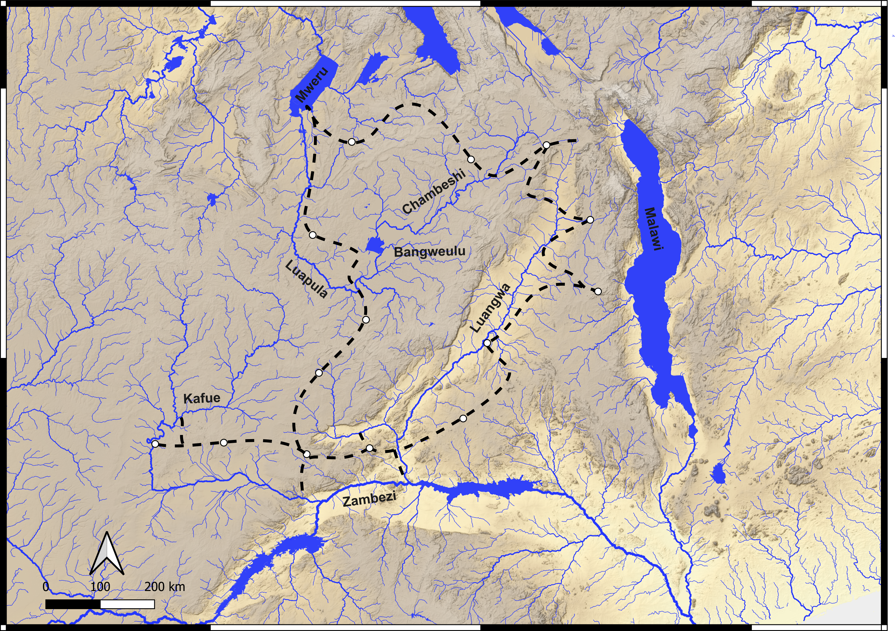

## Numbers

- 14 days
- ~4,500 km driven
- 39 mud samples
- 43 sand samples
- 33 rivers sampled
- 4 major drainages (Luapula-Chambeshi, Luangwa, Zambezi, Kafue)

I would like to thank my fellow travellers for their energy and good company, and the University of Zambia for the logistical support of the trip, in the persons of Dr Misheck Chundu and Professor Kawawa Banda; Mr Steve Tolan, for his help and advice in organising the route; and Mr Christopher Mwanza, for driving us so expertly across every kind of terrain.

  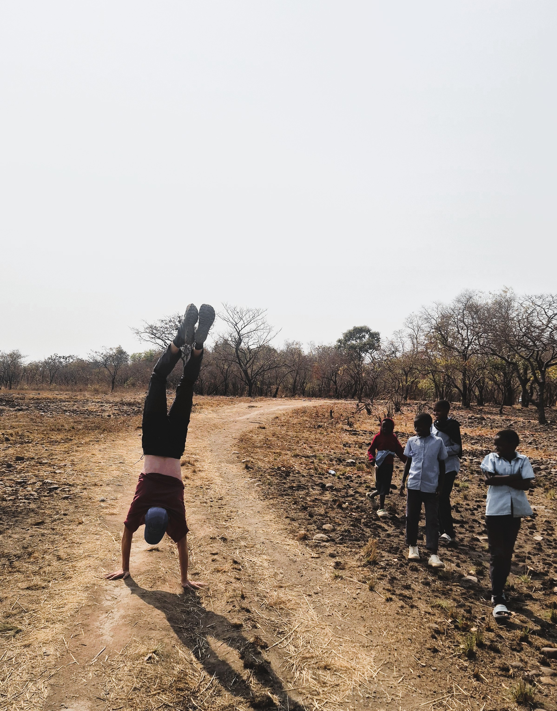

<blockquote>
<em>The watercourses were my guide, 
I travelled grateful by their side, 
Or through their channel dry; 
They led me through the thicket damp, 
Through brake and fern the beavers' camp, 
Through beds of granite cut my road, 
And their resistless friendship showed; 
The falling waters led me, 
The foodful waters fed me, 
And brought me to the lowest land, 
Unerring to the ocean sand.</em>
</blockquote>

<em>R.W. Emerson</em>

